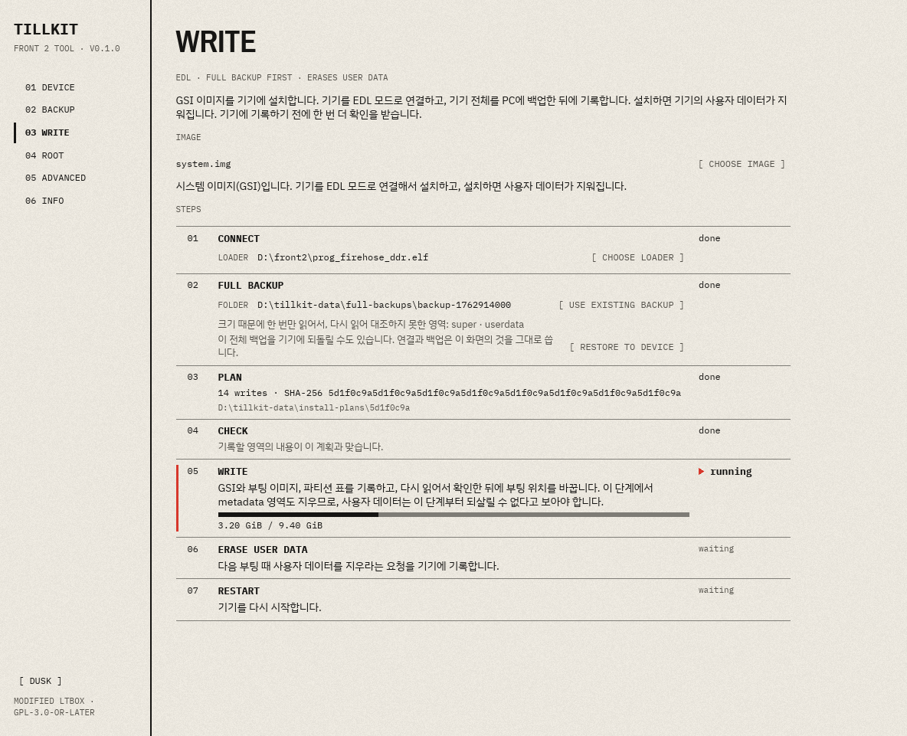
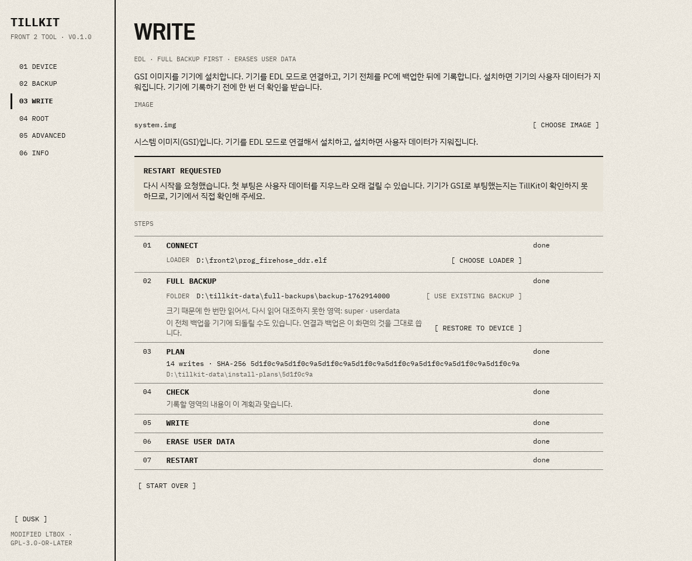
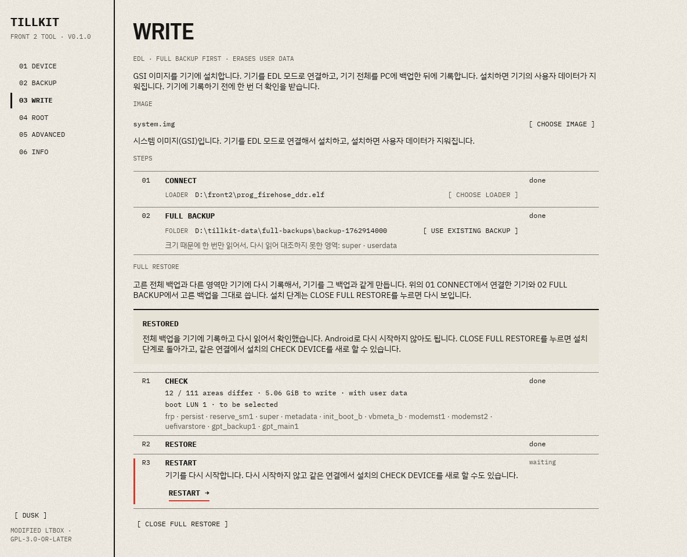

# TillKit

TillKit은 토스 프론트 2 단말에 GSI를 설치하고, 부팅 영역을 백업하고, 이미지를 기록하고, Magisk 루트 패치를 넣는 데스크톱 도구입니다.
GSI 설치는 순정 1.609.5 기기를 EDL 모드로 연결해서 합니다.
그 밖의 기능은 슬롯 B의 GSI로 전환했고 루트 권한이 이미 있는 기기에서 씁니다.

TillKit은 miner7222의 [LTBox](https://github.com/miner7222/LTBox)를 고친 판입니다.
LTBox의 Lenovo 전용 기능은 이 저장소에 없습니다.

[English](READMEs/README_en-US.md)



이 문서의 화면 그림은 예시입니다. 그림 속의 경로와 수치는 실제 기기에서 나온 값이 아닙니다.

## 시작하기 전에

> [!WARNING]
> 펌웨어를 바꾸면 기기가 부팅하지 못하게 되거나 데이터가 지워질 수 있습니다. 이 도구는 보증 없이 제공되며, 사용에 따른 책임은 사용자에게 있습니다.

- TillKit은 프론트 2 한 대에서만 시험했고, GSI 설치에서 기록과 사용자 데이터 삭제까지 마친 것은 순정 1.609.5의 전체 백업을 복원한 뒤뿐입니다. 실제 기기에서 확인하지 않은 기능이 많으니 아래 "실제 기기에서 검증하지 않은 것"을 먼저 읽어 주세요.
- 기록은 여러 파티션을 차례로 바꿉니다. 기록하는 도중에 전원이나 연결이 끊기면 기기가 부팅하지 못할 수 있습니다.
- 그 상태에서 복구하는 일반적인 방법은 기기 전체 백업을 EDL로 되돌리는 것입니다. TillKit은 GSI 설치 단계에서 전체 백업을 만들고, WRITE 화면에서 그 백업을 기기에 다시 기록할 수 있습니다. 아래 "전체 백업 복원"을 읽어 주세요.
- GSI를 설치하면 기기의 사용자 데이터가 지워집니다.
- 기기 전체 백업은 다른 곳에도 보관해 주세요. PC에 있는 백업이 손상되면 되돌릴 수 없습니다.

## 필요한 것

1. USB 디버깅을 켠 기기가 필요합니다.
   기기의 설정에서 빌드 번호를 일곱 번 눌러 개발자 옵션을 열고, 개발자 옵션에서 USB 디버깅을 켭니다.
   기기를 PC에 연결하면 기기 화면에 허용을 묻는 창이 뜨며, 여기에서 허용을 눌러야 합니다.
   메뉴의 이름과 위치는 기기에 설치한 시스템에 따라 다를 수 있습니다.
2. 기기에 루트 권한이 이미 있어야 합니다.
   USB 디버깅만으로는 부족하고, `adb root`가 되거나 기기에 `su`가 있어야 합니다.
   TillKit은 부팅 영역을 루트 권한으로 읽고 기록하기 때문에, 루트 권한이 없는 기기에서는 백업도 기록도 하지 못합니다.
3. PC에서 다른 ADB 프로그램이 같은 기기를 쓰고 있으면 먼저 꺼 주세요.

ROOT 화면은 루트 권한이 전혀 없는 기기를 루팅하는 기능이 아닙니다.
`adb root`만 되는 기기에 Magisk를 넣는 기능입니다.

GSI 설치에는 위의 루트 권한 대신 아래 두 가지가 필요합니다.

1. 기기가 EDL 모드로 PC에 연결되어 있어야 합니다.
   ADB가 연결된 기기는 ADVANCED 화면에서 EDL 모드로 다시 시작할 수 있습니다.
2. 이 기기의 Firehose 로더 파일이 필요합니다. TillKit은 이 파일을 함께 주지 않습니다.

EDL 모드의 기기는 ADB에 응답하지 않습니다. DEVICE 화면의 확인은 EDL 모드의 기기를 찾으면 찾았다고만 알려 주고 기기의 정보는 읽지 않으며, 찾지 못하면 기기를 읽지 못했다고 알려 줍니다. 어느 경우에도 GSI 설치는 DEVICE 화면을 거치지 않고 WRITE 화면에서 시작합니다.

## 지원하는 기기

DEVICE 화면은 아래 값을 모두 확인합니다.

| 검사 | 필요한 값 |
| --- | --- |
| `ro.product.vendor.manufacturer` | `TOSSPLACE` |
| `ro.product.vendor.device` | `toss_front2` |
| `ro.vendor.build.fingerprint` | `TOSSPLACE/toss_front2/toss_front2:13/TKQ1.230110.001/475:user/dev-keys` |
| `ro.soc.model` | `QCM4325` |
| `ro.board.platform` | `bengal` |
| `ro.build.ab_update` | `true` |
| `ro.boot.slot_suffix` | `_b` |
| `ro.boot.vbmeta.device_state` | `locked` |
| `ro.boot.verifiedbootstate` | `green` |
| `sys.boot_completed` | `1` |
| 루트 접근 | `adb root` 또는 `su` |

기기의 top `vbmeta`는 AOSP 테스트 키 `testkey_rsa4096`과 알고리즘 `SHA256_RSA4096`으로 서명되어 있어야 합니다.

값이 맞지 않는 기기에는 기록하지 않습니다.
다만 맞지 않는 항목을 확인한 뒤에 DEVICE 화면에서 강제로 진행할 수 있습니다.
강제로 진행해도 파일 대조와 기록 뒤의 확인은 그대로 하지만, 그 기기가 기록한 뒤에 부팅하는 것은 보장하지 않습니다.
루트 접근이 없는 기기, 부팅이 끝나지 않은 기기, 슬롯이 `_a`도 `_b`도 아닌 기기는 강제로도 진행할 수 없습니다.

## 화면

| 화면 | 기능 |
| --- | --- |
| DEVICE | 기기의 속성을 읽어서 지원하는 기기인지 알려 줍니다. 이 화면은 아무것도 기록하지 않습니다. |
| BACKUP | 기기의 `init_boot`, `boot`, `vbmeta`를 PC의 폴더에 읽어 둡니다. 저장할 폴더는 이 화면에서 고릅니다. 목록의 RESTORE는 그 백업의 이미지를 기기에 다시 기록합니다. |
| WRITE | 이미지 파일 하나를 고르고 WRITE를 누르면, 준비부터 확인까지 차례로 진행합니다. |
| ROOT | Magisk를 내려받아서 기기의 `init_boot`를 패치하고 기록합니다. |
| ADVANCED | 기기를 일반 부팅, 복구 모드, 부트로더(fastboot), EDL 모드로 다시 시작합니다. |
| INFO | 지원하지 않는 것과 고지를 보여 줍니다. |

### WRITE에서 고르는 이미지

이미지 파일 하나를 고릅니다. 파일 이름은 무엇이든 괜찮으며, 이미지의 종류는 파일의 헤더를 읽어서 판별합니다.

| 이미지 | 하는 일 |
| --- | --- |
| 커널이 없는 부트 이미지 | 다른 도구로 만든 루트 패치본(예: Magisk 앱으로 패치한 `init_boot` 이미지)으로 보고, 서명해서 `init_boot`와 `vbmeta`에 기록합니다. |
| 커널이 든 부트 이미지 | 커널 이미지로 보고, 서명해서 `boot`와 `vbmeta`에 기록합니다. 압축된 커널 이미지는 지원하지 않습니다. |
| 시스템 이미지 | GSI입니다. EDL 모드로 연결한 기기에 설치합니다. 아래 "GSI 설치"를 읽어 주세요. |

기록에 쓰는 백업은 BACKUP 화면의 폴더에서 TillKit이 찾으며, WRITE 화면에서 따로 고르지 않습니다.

### GSI 설치

WRITE 화면에서 시스템 이미지를 고르면 아래 단계가 차례로 열립니다.

1. 연결: Firehose 로더 파일을 고르고, EDL 모드의 기기에 연결합니다.
2. 전체 백업: 기기 전체를 데이터 폴더의 `full-backups`에 읽어 둡니다. 데이터 폴더에 전체 백업이 이미 있으면 가장 새 것을 TillKit이 찾아서 씁니다. 다른 폴더의 전체 백업을 고를 수도 있습니다.
3. 계획: 기록할 내용을 계획 파일로 만듭니다. 같은 이미지로 만든 계획이 데이터 폴더에 있으면 그중 가장 새 계획과 그 계획이 쓰던 전체 백업을 다시 씁니다. 그래서 멈춘 설치를 이어 할 때는 처음에 쓰던 백업과 계획이 그대로 쓰입니다. 그 전체 백업을 읽지 못하면 계획을 새로 만들지 않고 멈춰서 알려 줍니다. 전체 백업 폴더를 직접 고른 때에는 그 백업으로 만든 계획만 다시 씁니다. 새 계획은 파티션 표에서 부팅 슬롯이 A로 표시된 전체 백업으로만 만듭니다. 부팅 슬롯은 `boot_a`와 `boot_b`의 활성 표시로 판별합니다. 그 밖의 파티션 쌍은 B 쪽에 활성 표시가 없어야 하며, A와 B 어느 쪽에도 활성 표시가 없는 쌍은 받아들입니다. 순정 1.609.5 상태의 기기에서 만든 백업이 이 조건과 맞습니다. 조건과 맞지 않는 백업이면(예를 들어 이미 GSI를 설치한 기기에서 만든 백업이나 부팅 슬롯이 B로 표시된 기기에서 만든 백업) 파일을 만들기 전에 멈춰서 알려 줍니다. 전체 백업의 순정 빌드는 `vbmeta_a`에 들어 있는 `com.android.build.boot.fingerprint` 값으로 확인합니다. 이 값이 TillKit이 기준으로 삼은 빌드(`TOSSPLACE/toss_front2/toss_front2:13/TKQ1.230110.001/475:user/dev-keys`)와 빌드 번호(`475`)만 다르면, 경고 창에서 CONTINUE ANYWAY를 눌러 승인한 때에만 계획을 만듭니다. 빌드 번호가 아닌 부분이 다르거나 값이 하나가 아니면 계획을 만들지 않고, 백업에서 읽은 값을 알려 줍니다.
4. 점검: 기기를 읽어서 계획과 맞는지 확인합니다. 처음 설치인지, 멈춘 설치를 이어 하는지를 여기서 알려 줍니다. 이 단계까지는 기기에 기록하지 않습니다.
5. 기록: 확인 창에서 승인하면 이미지와 파티션 표를 기록하고, 부팅 위치를 바꿉니다. 기록한 영역은 모두 다시 읽어서 확인합니다.
6. 사용자 데이터 삭제: 기록에 이어서 진행합니다. 5번의 확인 창이 이 삭제도 함께 묻습니다.
7. 다시 시작: 따로 묻습니다.



- 기록이 중간에 멈추면 기기가 부팅하지 못할 수 있습니다. 기기를 EDL 모드로 둔 채 다시 점검하면, 멈춘 단계를 찾았을 때 그 단계부터 이어서 기록합니다. 전체 백업을 기기에 다시 기록하려면 아래의 전체 백업 복원을 씁니다.
- 계획이 기록하지 않는 파티션 표가 전체 백업과 다르면 점검이 멈추고, 전체 백업을 기기에 먼저 되돌리라고 알려 줍니다.
- 기기에 저장된 rollback 값과 기록할 이미지의 값이 맞는지는 TillKit이 확인하지 못합니다.
- 다시 시작한 기기가 GSI로 부팅했는지는 TillKit이 확인하지 못합니다.

### 전체 백업 복원

전체 백업 복원은 기기 전체 백업을 기기에 다시 기록합니다. GSI 설치의 2번 단계에 전체 백업이 골라져 있으면, RESTORE TO DEVICE로 복원을 엽니다. 복원은 1번 단계의 연결과 2번 단계의 전체 백업을 그대로 쓰고, 로더나 폴더를 다시 묻지 않습니다.

1. 점검: 기기를 읽어서 영역마다 전체 백업에 기록된 해시와 비교합니다. 다른 영역의 수와 이름, 기록할 양, 부팅 위치를 보여 줍니다. 사용자 데이터(`userdata`)도 되돌리는 것이 기본입니다. 이 선택을 끄면 `userdata`는 비교하지도 기록하지도 않습니다.
2. 복원: 확인 창에서 승인하면 다른 영역만 기록하고, 영역마다 다시 읽어서 해시를 확인한 뒤에 부팅 위치를 맞춥니다.
3. 다시 시작: 꼭 하지 않아도 됩니다. 다시 시작하지 않고 같은 연결에서 GSI 설치의 점검을 새로 할 수 있습니다.



- 기기가 전체 백업과 같으면 기록할 것이 없다고 알려 주고 기록하지 않습니다.
- LUN 1이나 LUN 2의 파티션이 다르면 기록하지 않습니다. 이 파티션에는 부팅 초기 이미지가 들어 있습니다.
- 부팅 위치는 전체 백업의 파티션 표에서 `xbl` 항목의 활성 표시로 정합니다. 백업을 만들 때 기기가 실제로 그 LUN으로 부팅했는지는 TillKit이 확인하지 못합니다.
- 이 백업이 이 기기의 것인지는 TillKit이 확인하지 못합니다. 복원하면 기기마다 다른 보정 자료도 백업의 것으로 바뀝니다.
- 사용자 데이터를 빼고 복원하면, 다음에 부팅할 때 Android가 초기화를 요구할 수 있습니다.
- 복원이 중간에 멈추면 기기를 EDL 모드로 둔 채 다시 점검해 주세요. 아직 다른 영역만 기록합니다.

### 기록의 안전 단계

1. 기기의 지금 이미지가 BACKUP 화면의 백업에 있어야 기록을 준비할 수 있습니다. 그래서 먼저 백업해야 합니다.
2. 기록할 내용은 계획 파일로 저장되고, 승인은 그 파일의 SHA-256에 묶입니다.
3. 기기에 기록하기 전에 확인 창에서 기록할 영역과 실패 시 복구본을 보여 주고 한 번 더 묻습니다.
4. 기기에서 도는 스크립트가 기록하기 직전에 기기의 속성과 이미지를 다시 검사합니다.
5. 기록이 중간에 실패하면 스크립트가 이전 이미지를 다시 기록하고 다시 읽어서 확인합니다.
6. 재부팅은 따로 묻고, 기록한 내용을 다시 읽어서 확인한 뒤에만 할 수 있습니다.

기록한 커널로 부팅하지 못하면, TillKit으로는 이전 커널로 되돌릴 수 없습니다.

### ROOT

- ROOT를 누르면 Magisk의 최신 판을 `github.com/topjohnwu/Magisk`에서 내려받습니다. TillKit은 Magisk를 함께 배포하지 않습니다.
- 이미 Magisk가 들어 있는 `init_boot`는 다시 패치하지 않습니다.
- TillKit은 기기에 Magisk 앱을 설치하지 않습니다. 재부팅한 뒤에 Magisk 앱을 직접 설치해 주세요.
- 다른 방식의 루트 패치는 만들지 않습니다. 다른 도구로 만든 `init_boot` 이미지는 WRITE 화면에서 기록할 수 있습니다.

### ADVANCED

- 갈 수 있는 모드는 기기의 지금 연결 상태에 따라 다릅니다.
- EDL 모드에서 일반 부팅으로 돌아오려면 이 기기의 Firehose 로더 파일이 필요합니다. TillKit은 이 파일을 함께 주지 않습니다.
- 결과를 확인하지 못한 기록이 있으면 재부팅을 요청하지 않습니다.

## 실제 기기에서 검증하지 않은 것

TillKit의 화면으로 실제 기기에서 실행해 본 것은 프론트 2 한 대에서 한 아래 세 가지뿐입니다.

- 전체 백업 만들기: EDL 연결과 전체 백업. 이때 기기의 내용은 순정 1.609.5와 달랐습니다.
- 전체 백업 복원: 순정 1.609.5의 전체 백업을 점검하고, 사용자 데이터를 포함해 기록한 뒤 부팅 위치(boot LUN)를 선택.
- GSI 설치: 위의 복원을 마친 기기에서 한 계획, 점검, 기록, 사용자 데이터 삭제.

아래 항목은 실제 기기에서 확인하지 않았습니다. 모의 장치와 로컬 셸에서만 시험했습니다.

- GSI 설치의 다시 시작 단계와, TillKit이 GSI를 기록한 기기의 부팅. 기록한 뒤의 기기 화면은 확인하지 못했습니다.
- 순정 상태의 기기에서 전체 백업을 만들고 그 백업으로 GSI 설치를 이어서 하는 것.
- 펌웨어가 1.609.5가 아닌 기기의 GSI 설치. 빌드 번호가 다른 순정 빌드는 경고를 승인하면 계획을 만들 수 있지만, 그런 계획으로 설치해 본 적은 없습니다.
- 파티션 표에서 A와 B 어느 쪽에도 활성 표시가 없는 파티션 쌍이 있는 기기의 GSI 설치.
- 중간에 멈춘 GSI 설치를 멈춘 단계부터 이어 하는 것.
- 전체 백업 복원에서 사용자 데이터를 빼는 것, 그리고 복원한 뒤의 다시 시작과 순정 부팅.
- 루트 권한으로 하는 백업, 기록, 되돌리기(RESTORE).
- TillKit이 Magisk로 패치한 이미지의 부팅.
- TillKit이 서명한 커널 이미지의 부팅.
- `su`를 거친 기록.
- DEVICE 화면이 EDL 모드의 기기를 찾는 것.
- ADVANCED 화면의 재부팅.
- Magisk를 GitHub에서 내려받는 경로.
- 강제로 진행한 기기에서의 기록.
- 전원이 끊긴 뒤의 EDL 복구.

## 이 도구에 없는 것

- 부팅 슬롯이 B로 표시된 순정 기기의 GSI 설치. 설치는 부팅 슬롯을 A에서 B로 바꾸는 것만 합니다.
- 루트 권한이 없는 기기에 기록하기, 그리고 그런 기기의 루트 확보
- 기록한 뒤에 부팅하지 못하는 기기의 복구
- 기기의 `/data/local/tmp/front2-write-*` 자동 정리
- 기기 명령의 시간 제한. 기록 중에 기기가 응답하지 않으면 도구는 계속 기다리며, 그때의 기록 상태는 알 수 없습니다. 도구는 자동으로 다시 시도하거나 재부팅하지 않습니다.

## 저장소에 넣으면 안 되는 파일

실제 기기의 이미지, 펌웨어, 로더, 기기 로그, 키, 백업을 저장소에 넣지 않습니다.
`.gitignore`가 흔한 파일 형식을 막지만, 커밋마다 직접 확인해야 합니다.
도구의 데이터는 BACKUP 화면에서 고른 폴더에 저장됩니다.
폴더를 고르지 않으면 실행 파일 옆의 `tillkit-data` 폴더를 씁니다.
고른 폴더의 경로는 실행 파일 옆의 `tillkit-folder.json`에 적어 둡니다.
백업은 `pairs`와 `kernel-sets`에, 기록 계획은 `plans`에, 내려받은 Magisk는 `magisk`에 있습니다.
USB로 직접 연결할 때 쓰는 ADB 키는 이 폴더에 두지 않습니다. Windows에서는 `%LOCALAPPDATA%\ltbox\adb\adbkey`에 있습니다.

## 빌드

```sh
cargo build --release --locked -p tillkit
```

실행 파일은 `target/release/tillkit`(Windows에서는 `tillkit.exe`)입니다. 지금까지는 Windows에서만 빌드하고 실행했습니다.

실행 파일을 `target/release`에서 바로 실행하면 기본 데이터 폴더가 `target/release/tillkit-data`가 됩니다. `cargo clean`은 빌드 결과와 함께 이 폴더도 지우므로 백업이 함께 없어집니다. 백업하기 전에 실행 파일을 다른 폴더로 복사하거나 BACKUP 화면에서 데이터 폴더를 골라 주세요.

## 라이선스와 고지

TillKit은 LTBox와 같은 [GPL-3.0-or-later](LICENSE)를 따릅니다. 원저작물과 제3자 구성 요소의 고지, LTBox에서 바뀐 내용은 [영문 README](READMEs/README_en-US.md)에 있습니다.
